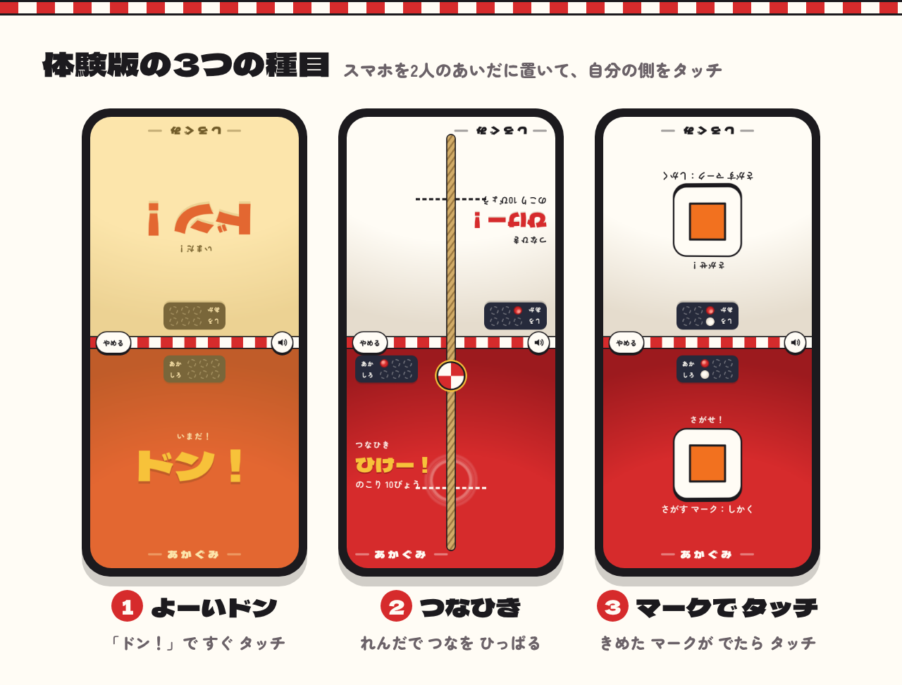

# タッチうんどうかい（体験版）

スマホ1台を2人のあいだに置いて、向かい合って対戦するゲームです。スマホのブラウザで、インストールなしで遊べます。

- 遊ぶ：https://paz67416.github.io/touch-undokai/
- 体験版で遊べるのは、よーいドン・つなひき・マークでタッチの3つです（先に3点とったほうが勝ち）
- 完全版（種目が8つ・子どもが勝ちやすくなるハンデ・何点先取と種目の選択・名前・対戦の記録）は note の記事で案内しています：https://note.com/chodo_lab

1枚のHTMLで動きます。遊んだ内容はどこにも送信しません（ブラウザに覚えるのは、音のオン・オフだけです）。

作った人：余白の実験室（https://note.com/chodo_lab）
